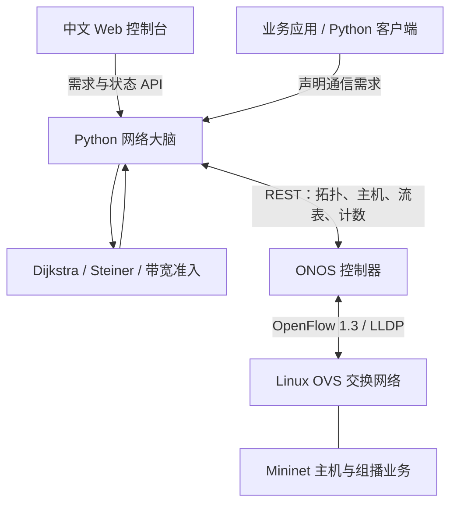

# 2026-11-02 更新：requests + Sanic 负载感知版本

网络 HTTP 客户端统一使用 requests，网页和 API 统一使用 Sanic，移除了 urllib 和 http.server。文件、时间、线程、算法等基础模块仍使用 Python 工具库。

## 动态负载选路

- 约每 1 秒查询 ONOS `/statistics/ports`、拓扑和流表。使用源端口的 `bytesSent` 差值以及交换机 `durationSec` 差值计算有向链路发送速率。ONOS 的实际统计刷新频率决定有效采样速度，不能承诺硬实时或毫秒切换。
- 首次采样、计数器重置、缺失统计或统计超过 15 秒未更新时，将对应链路从可行图中排除。只有再次获得有效差分样本才能使用。
- 从实测负载中扣除本应用已观测且已声明预留的部分，避免将同一业务重复计费。超出声明预留的流量仍算背景负载。流表和端口统计并非原子快照，实验时需检查采样偏差。
- 背景负载使用 EWMA 平滑，alpha=0.3。动态 cost = 配置 cost × (1 + 4 × 背景利用率档位²)，档位间隔为 10%。可用容量 = 物理容量 − 平滑背景负载。之后再按通信需求扣除预留带宽。
- 负载变化最短 5 秒更新一次路由指标，减少抖动。拓扑、统计有效性和需求改变会立即触发计算；安装耗时可能延长实际响应时间。启用页面闭环后自动下发。
- 动态权重通常使双向代价不再对称，此时组播使用有向启发式，不保证全局最优。

页面链路行新增“测量总负载”；演示模式的数值输入为**模拟背景负载 Mbps**，仅修改显示箭头对应方向。将当前路径某条链路调到 90 Mbps，可在拓扑不变时观察备用路径。它不是实网统计。

先安装依赖，再启动：

```bash
python3 -m pip install -r requirements.txt
python3 -m sdn.server
# 实网模式
SDN_MODE=onos python3 -m sdn.server
```

Linux 验收应额外在某条中间链路注入背景流量并对照 `ovs-ofctl dump-ports`。检查统计变化、动态 cost、备用路径和实际收包情况；停止背景流量后观察平滑恢复。已在 Ubuntu-SDN 虚拟机完成真实单播和组播收包检查。真实负载改路压力验收仍未完成，详见 VM_RUNBOOK.md。历史 PPT 描述的是之前版本。

---

# SDN Brain：ONOS + OVS + Python 动态路由实验系统

中文控制台、Python 决策服务和 Linux 实验脚本。默认以演示模式运行，使用 requests 和 Sanic，先安装 requirements.txt；真实网络使用 ONOS 北向 REST 与 OVS 的 OpenFlow 1.3 南向连接。



## 已实现

| 功能 | 实现 |
|---|---|
| 拓扑感知 | 约每 1 秒读取 ONOS devices、links、hosts，识别设备、链路和接入位置变化 |
| 单播 | 有向图 Dijkstra，按链路 cost 求最短路径，可同时计算反向路径 |
| 多通信对 | 优先级降序、带宽降序准入；按有向链路预留带宽，容量不足则拒绝整条需求 |
| 组播 | 小规模对称网络精确 Steiner；较大/不对称网络使用增量最短路径树启发式 |
| 转发 | 精确匹配入口端口、IPv4 源/目的地址；组播分支使用多个 OUTPUT 复制 |
| 动态重算 | 显式启用闭环后，拓扑或需求改变自动计算、安装并删除本应用过时规则 |
| 安装核验 | 批量提交缺少的规则，统一检查 ONOS ADDED 状态；安装成功后删除旧规则并核验收敛 |
| 需求感知 | 页面、REST API 或 Python 客户端主动声明；入口流表字节计数显示实际速率 |
| 页面 | 拓扑、路径高亮、需求管理、链路预留、控制事件；演示模式可模拟断链 |

## 1. 本机演示

Python 3.10 或更高版本。在项目根目录执行：

```bash
python3 -m pip install -r requirements.txt
python3 -m sdn.server
```

浏览器访问 **http://127.0.0.1:8000**。默认包含 6 台交换机、8 条物理链路、6 台主机、1 条组播需求和 1 条双向单播需求。点击“启用闭环下发”，再切换链路在线状态；路径和准入结果会重算。演示模式明确标记“模拟下发”，不会访问真实 ONOS。

Windows 可用 `python -m sdn.server`。服务不依赖前端构建或 CDN。

## 2. Linux 实验环境

推荐独立的 Ubuntu 22.04/24.04 实验虚拟机；需要 Docker Engine 与 Compose 插件、Python 3、Mininet、OVS、arping、iperf3。以下为新环境的手工部署说明。当前 VirtualBox 实例采用独立的 csdn_ 拓扑和项目目录，具体运行方式见 VM_RUNBOOK.md。

```bash
sudo apt update
sudo apt install -y python3 mininet openvswitch-switch iputils-arping iperf3
sudo systemctl start openvswitch-switch
docker compose -f lab/compose.yaml up -d
```

Compose 固定 `onosproject/onos:2.7.0` 以便复现实验；这是历史版本，不代表最新推荐版本。首次启动可能需要数分钟。用 ONOS 自带 Swagger `http://127.0.0.1:8181/onos/v1/docs/` 对照目标版本接口。

```bash
curl -u onos:rocks http://127.0.0.1:8181/onos/v1/devices
python3 lab/activate.py
```

`activate.py` 激活 drivers、openflow、lldpprovider、hostprovider，并停用可能冲突的 `org.onosproject.fwd`。请在专用实验实例执行。默认账号仅供实验，真实环境通过 `ONOS_USER`、`ONOS_PASSWORD` 指定凭据。

终端 A 启动数据平面：

```bash
sudo /usr/bin/python3 lab/topology.py --controller 127.0.0.1
```

该脚本启用 OpenFlow 1.3、设置静态 ARP，并发送 gratuitous ARP 供 ONOS 发现主机。首先确认 ONOS 返回 6 个在线设备、6 个主机和双向链路。尚未发现主机时，在 Mininet CLI 中执行对应主机的 `arping`，例如：

```text
h1 arping -U -c 2 -I h1-eth0 10.0.0.1
```

终端 B 启动实网决策层：

```bash
export SDN_MODE=onos
export ONOS_URL=http://127.0.0.1:8181
export ONOS_USER=onos
export ONOS_PASSWORD=rocks
python3 -m sdn.server
```

打开控制台，确认“ONOS 已连接”。实网模式初始需求为空，需要通过页面或应用客户端添加，然后点击“启用闭环下发”。在页面启用前服务只读拓扑和流量计数。重启服务后需重新启用闭环，需求会从 `data/onos-demands.json` 恢复。

### 应用自动上报需求

应用在开始业务通信前调用 `sdn.client.Client.register()`，或使用：

```bash
python3 -m sdn.client --id video --source 10.0.0.1 \
  --receivers 10.0.0.4 10.0.0.5 10.0.0.6 --group 239.1.1.1 --mbps 20
python3 -m sdn.client --id pair --source 10.0.0.2 --receivers 10.0.0.6 --mbps 15
```

这让“大脑”主动感知应用声明的通信需求。计数采集是被动观测，**不能从未匹配首包推断未来需求，也不自动识别 IGMP 成员关系**。需要完全被动的新流发现时，应增加 ONOS Java PacketProcessor 扩展，经事件接口通知 Python；ONOS 原生内部应用通常是 Java，Python 位于外部决策层。

### 实验验证

1. 添加双向单播需求 `10.0.0.2 → 10.0.0.6` 并启用闭环；确认页面为“ONOS 已确认 ADDED”。在 Mininet 中执行 `h2 ping -c 5 10.0.0.6`。
2. 对同一通信对，启动 `h6 iperf3 -s -D` 后执行 `h2 iperf3 -c 10.0.0.6 -t 15`，观察入口速率。预留带宽不限制实际发送速率。
3. 注册 `video` 组播需求后，在 h4/h5/h6 启动接收端，然后在 h1 发包。命令中的 `/ABS/PATH` 替换为 Linux 项目的绝对路径：

```text
h4 python3 /ABS/PATH/lab/traffic.py receive --interface 10.0.0.4 --seconds 30 > /tmp/h4-mcast.log 2>&1 &
h5 python3 /ABS/PATH/lab/traffic.py receive --interface 10.0.0.5 --seconds 30 > /tmp/h5-mcast.log 2>&1 &
h6 python3 /ABS/PATH/lab/traffic.py receive --interface 10.0.0.6 --seconds 30 > /tmp/h6-mcast.log 2>&1 &
h1 python3 /ABS/PATH/lab/traffic.py send --interface 10.0.0.1 --seconds 20 --mbps 1
h4 cat /tmp/h4-mcast.log
h5 cat /tmp/h5-mcast.log
h6 cat /tmp/h6-mcast.log
```

三台接收端应收到包且 duplicates 为 0。可在未注册的 h3 同时启动接收端，确认没有业务流量泄漏。组播收发脚本用于连通性验证，不是精密流量发生器。

4. 在 Mininet 中执行 `link s2 s4 down`。等待 ONOS 发现变化及 Python 下一次轮询，观察重算事件和备用路径，再执行 `link s2 s4 up`。
5. 删除业务需求，确认本应用规则被移除。`pingall` 不应作为全通验收条件，因为没有声明的通信对不会自动安装转发表。

查看实际交换机规则：

```bash
sudo ovs-ofctl -O OpenFlow13 dump-flows s1
curl -u onos:rocks http://127.0.0.1:8181/onos/v1/flows/application/org.example.sdnbrain
```

### 实验清理

先在页面删除所有需求并等待规则数量收敛到 0，再暂停闭环。若服务已经停止，可在确认没有本项目进程继续下发后，只删除本项目应用规则：

```bash
curl -u onos:rocks -X DELETE \
  http://127.0.0.1:8181/onos/v1/flows/application/org.example.sdnbrain
```

Mininet CLI 输入 `exit` 关闭本次网络；需要清理残留实验状态时，在专用实验机执行 `sudo mn -c`。不需要 ONOS 后执行 `docker compose -f lab/compose.yaml down`。

## 3. 参数与链路配置

| 环境变量 | 默认 | 用途 |
|---|---|---|
| SDN_MODE | demo | demo / onos |
| SDN_HOST / SDN_PORT | 127.0.0.1 / 8000 | 页面和 API 监听地址 |
| ONOS_URL | http://127.0.0.1:8181 | ONOS 地址，不包含 /onos/v1 |
| ONOS_USER / ONOS_PASSWORD | onos / rocks | 实验凭据 |
| SDN_API_TOKEN | 空 | 页面/API 访问令牌，非回环监听时必须设置 |
| SDN_ALLOWED_HOSTS | 空 | 额外允许的 Host，逗号分隔，如 192.168.1.50:8000 |
| SDN_METRICS | config/metrics.json | 链路 cost 和容量配置，启动时读取 |
| SDN_STATE | data/模式-demands.json | 需求持久化位置 |

真实网络默认 cost=1（最少跳数）、capacity=100 Mbps。它们是配置值，不是实测时延或自动测速结果。修改 `config/metrics.json`，按 ONOS connect point 精确指定有向链路，重启服务生效：

```json
{
  "default": {"cost": 1, "capacity": 100},
  "of:0000000000000001/1>of:0000000000000002/1": {"cost": 2, "capacity": 50}
}
```

反向链路需独立配置。演示拓扑使用固定的不同权重帮助演示；Linux 默认等权，路径可能与演示不同。

默认同机回环访问；Linux 虚拟机可用 SSH 转发 `ssh -L 8000:127.0.0.1:8000 user@VM_IP` 后在本机浏览器访问。若需局域网监听，设置 `SDN_HOST=0.0.0.0`、强访问令牌和实际 `SDN_ALLOWED_HOSTS`，页面点击“访问令牌”输入。跨不可信网络需自行配置 HTTPS；ONOS 密码不会发给浏览器。

## 4. 算法边界

- 单播 Dijkstra 在当前剩余带宽可行图上对正权链路精确最短。
- 组播“最佳”定义为所有接收端连通且树上链路权重之和最小；不是各接收端距离分别最短。双向完全对称、节点数 ≤20、非终端候选节点 ≤12 时，枚举候选 Steiner 节点子集并求诱导子图 MST，得到该模型的精确最优树。否则用有向增量最短路径树，明确标注启发式；其失败不证明原问题无解。
- 多需求联合路由采用顺序贪心准入，**不保证多通信对联合最优**。需要联合最优可扩展 MILP/多商品流模型。组播仅在有向树的每条边预留一次带宽，共用前缀不会为每个接收者重复计费。
- 仅对交换机间链路做预留，没有对主机接入带宽、交换机背板、时延、丢包进行约束；不执行 Meter/QoS 整形；本版本已把实测背景负载用于动态调权。
- 当前支持无 VLAN 的单归属 IPv4 主机、静态组播成员和源特定的组播匹配。不支持 VLAN、IPv6、IGMP snooping、ECMP、跨子网 L3 路由/MAC 重写。
- 分支规则使用 OpenFlow 多 OUTPUT 指令，OVS 在各端口复制相同帧。未实现 ALL Group 表；如需组表原子更新，可扩展 ONOS Group API。
- 约每 1 秒发现拓扑，启用闭环后约每 10 秒核验规则；时间不含 ONOS 发现、REST 请求和安装时间。更新不是跨交换机事务，故障/重路由过程中可能短暂丢包或重复，不能宣称无损切换。
- 规则使用常驻模式，由决策服务显式删除过时规则。服务退出后规则仍会保留，需按上文清理；暂停不会撤回已开始的下发。安装失败可能留下部分规则，服务会重试收敛。批量提交不提供跨交换机原子更新或严格的下游先安装保证。
- ADDED 是 ONOS 的安装状态证据，不替代实际 ping、抓包和组播收包验收。单个应用 ID 假定由一个 Brain 实例独占；不要多个实例同时控制它。

## 5. 项目结构与测试

```text
sdn/routing.py        单播、Steiner/启发式、带宽准入、流表编译
sdn/onos.py           ONOS 拓扑读取、流表安装与核验
sdn/server.py         HTTP API、轮询闭环、需求持久化、流量采集
sdn/client.py         业务应用声明需求的 Python 客户端
web/                 无构建步骤的中文前端
lab/                 Docker、Mininet、激活脚本、组播收发验证
config/metrics.json  配置容量与正权 cost
tests/               路由与控制器适配测试
```

```bash
python3 -m pip install -r requirements-dev.txt
python3 -m unittest discover -s tests -v
```

API：`GET /api/state` 获取快照；`POST /api/demands` 以 `{revision, demands}` 替换需求集；`POST /api/apply` 以 `{revision}` 启用闭环；`POST /api/pause` 以 `{}` 暂停后续下发。修改请求均为 JSON，带令牌时使用 `X-API-Token`。revision 是乐观并发控制版本，过期时返回 400，应重新读取后合并。API 上报仅保存需求，不代表已经准入或转发成功，需检查 state 的 plan 和 install 字段。

## 官方参考

- [ONOS REST API](https://wiki.onosproject.org/display/ONOS/Appendix+B%3A+REST+API)
- [ONOS Flow Rules](https://wiki.onosproject.org/display/ONOS/Flow+Rules)
- [ONOS Flow REST 实现](https://github.com/opennetworkinglab/onos/blob/master/web/api/src/main/java/org/onosproject/rest/resources/FlowsWebResource.java)
- [ONOS Flow JSON codec](https://github.com/opennetworkinglab/onos/blob/master/core/common/src/main/java/org/onosproject/codec/impl/FlowRuleCodec.java)
- [Open vSwitch OpenFlow 配置](https://docs.openvswitch.org/en/stable/faq/openflow/)
- [Mininet 实验指南](https://mininet.org/walkthrough/)

ONOS Wiki 提示其内容恢复到 2022 年备份；最终接口应以运行实例的 Swagger 和版本源码为准。
